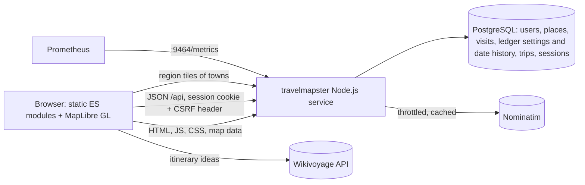

# Architecture Overview And ADR Index

## System At A Glance



One Express 5 process serves both the static frontend in `public/` and the JSON API under
`/api`. There is no frontend build step: the browser loads native ES modules. State lives in
PostgreSQL, including sessions, so any replica can serve any request.

## Backend

| Module | Responsibility |
|---|---|
| `src/server.js` | Startup: config, migrations with retry, HTTP and metrics servers, graceful shutdown |
| `src/app.js` | Express wiring: probes, logging, metrics, security headers, pages and static files, sessions, rate limits, CSRF, routers, error handling |
| `src/assets.js` | Release fingerprint and the HTML pages with their asset links rewritten |
| `src/precompressed.js` | Brotli for static text files: map data from its `.br` copies on disk, scripts and styles compressed once and kept in memory |
| `src/seo.js` | `robots.txt` and the sitemap of public pages ([ADR 0011](adr/0011-public-pages.md)) |
| `src/config.js` | Validated configuration from environment variables ([reference](development.md#configuration)) |
| `src/routes/` | `auth`, `markers` (places and their visits), `visits`, `ledger` (day-ledger settings and date history), `trips`, `profile` (incl. public maps), `export` (the account archive), `places` and `geocode` routers |
| `src/validation.js`, `ledger-validation.js`, `validation-text.js` | Every request-body rule and limit; the day ledger's settings in their own module |
| `src/rate-limit-store.js` | Rate-limit counters in PostgreSQL, shared by every replica |
| `src/repositories.js` | SQL access, always scoped to the signed-in user (visits through their place) |
| `src/db/migrations/005_day_ledger.sql` | Ledger tables and the triggers that record every change to visit dates ([ADR 0010](adr/0010-day-ledger.md)) |
| `src/services/geocoder.js` | Nominatim client with throttling, timeout and LRU cache |
| `src/services/places.js` | In-memory search over every town in the map data |
| `src/db/` | Connection pool, transactions and [migrations](data-model.md#migrations) |
| `src/middleware/csrf.js` | Synchronizer-token CSRF protection |

## Pages

| Path | Page |
|---|---|
| `/` | The app (`index.html`): the landing page with a demo map when signed out, the user's map when signed in, or a read-only shared map at `/?u=<username>` (sent with `X-Robots-Tag: noindex`) |
| `/schengen-calculator` | The free Schengen 90/180 calculator (`schengen-calculator.html`); `/schengen-calculator.html` redirects here |
| `/manifest.webmanifest`, `/sw.js` | The installable app's manifest and its service worker, which keeps the app, the map data and the traveler's last loaded data for offline use ([ADR 0021](adr/0021-installable-offline-app.md)) |
| `/embed/<username>` | A public map for other sites to frame (`embed.html`), the only page that may be framed, sent with `X-Robots-Tag: noindex` ([ADR 0020](adr/0020-embeddable-map.md)) |
| `/robots.txt`, `/sitemap.xml` | Crawler rules and the public pages, with absolute URLs from `PUBLIC_URL` or the request |

## API

JSON under `/api`, described in full in [OpenAPI](api/openapi.json) and kept backward compatible
([ADR 0019](adr/0019-api-description-and-versioning.md)); errors are `{ "error": "…" }` with a matching status. All routes except
`csrf-token`, `auth` and `public` need a session, and writes need the CSRF header
([security](security.md#request-protection)). Field rules are in the [data model](data-model.md#tables).

| Method | Path | Purpose |
|---|---|---|
| GET | `/api/csrf-token` | CSRF token for the current session |
| POST | `/api/auth/register`, `/api/auth/login`, `/api/auth/logout` | Account and session; responses include a fresh CSRF token. Sign-ups have their own rate limit, and one with the honeypot field `website` filled in is refused |
| GET | `/api/auth/me` | Current user, or 401 |
| POST | `/api/auth/password` | Change password (`currentPassword`, `newPassword`); signs out other sessions |
| DELETE | `/api/auth/account` | Delete the account and all its data (`password`); signs out everywhere |
| GET, POST | `/api/markers` | List saved places, each with its visits newest first, or create one (optionally with `visits`, `rating`, `tags`, `emoji`, `hideFromPublic`, `priority`, `bestMonths` and `stay`: `visit`, `lived` or `transit` for places been to, [ADR 0014](adr/0014-home-lived-and-transit.md)) |
| POST | `/api/markers/import` | Import up to 1,000 places with their visits |
| POST | `/api/markers/bulk` | Apply up to 300 changes all or nothing: places to `create`, status changes to `update` (`{ id, type }`, with an optional `stay`) and ids to `remove`; marking several countries at once and its undo are one call each. Returns `created`, `updated` and `removed`; any id not the caller's is a 404 and nothing is kept |
| PATCH, DELETE | `/api/markers/:id` | Update or remove a place; an update leaves visits alone unless an old client sends `travelDate` ([ADR 0009](adr/0009-places-and-visits.md)), and keeps `rating`, `tags`, `emoji`, `hideFromPublic`, `priority`, `bestMonths` and `stay` unless it sends them ([ADR 0012](adr/0012-place-details.md)); moving a place to the wishlist resets `stay` |
| GET, POST | `/api/markers/:id/visits` | List or add visits of a place (`startDate`, `endDate`, `ongoing`, `notes`, `photoUrl`) |
| PATCH, DELETE | `/api/visits/:id` | Replace or remove a visit |
| GET, PUT | `/api/ledger` | Day-ledger settings: `dayRule`, `rules` (stay rules and thresholds) and `planned` stays, replaced as a whole ([ADR 0010](adr/0010-day-ledger.md)) |
| GET | `/api/ledger/changes` | History of visit dates, newest first (latest 5,000) |
| GET, POST | `/api/trips` | List or create itineraries |
| PUT, DELETE | `/api/trips/:id` | Replace or remove an itinerary |
| GET | `/api/export` | Everything the account holds, for the data archive: `profile` (with the last active day), `places` with their visits, `trips`, and `ledger` with its `settings` and the whole date history (`changes`); `format` and `version` describe the document |
| PATCH | `/api/profile` | Change account settings, each optional: `profileVisibility` (`private` or `public`), `homeCountry` (a map code or `null`), `countryList` (`all` or `un`, [ADR 0015](adr/0015-country-lists.md)), `mapPalette` (`standard`, `colorblind` or `print`), `publicJourneys` (a boolean, [ADR 0016](adr/0016-timeline-journeys-and-palettes.md)) and `goals` (up to 12 yearly goals, one per kind and year); returns them all |
| GET | `/api/public/:username` | Read-only public map with the owner's `countryList`, `showJourneys` (whether visitors see journey lines), visit dates and each place's `stay`, without notes, photo links, ratings, tags, emoji, wishlist plans, the palette or the home country, and without places hidden from it ([ADR 0013](adr/0013-hidden-places.md)) |
| GET | `/api/places?q=&limit=` | Search every town in the map data (public, 1–20 results) |
| GET | `/api/geocode?q=&kind=city\|country&limit=` | World place search (1–10 results) |

## Frontend

| Module | Responsibility |
|---|---|
| `public/js/app.js` | App shell: state, saving places, map filters, tabs, the signed-in, signed-out (demo map) and public views, and the context every feature module receives. A signed-out visitor sees the landing panel while MapLibre (loaded on demand) and the map data arrive |
| `public/js/cards.js`, `card-visits.js`, `place-form.js` | Map cards for countries and cities, the visits on them, and the form that edits a saved place |
| `public/js/search.js`, `explore.js`, `selection.js` | Place search and "Surprise me", the Explore tab and travel ideas, and picking several countries to mark at once |
| `public/js/account.js` | Landing page sign-up and log-in (with the honeypot field), the account menu and settings |
| `public/js/panel.js`, `offline.js` | The side panel and the legend's filters, and registering the service worker |
| `public/js/share-cards.js`, `passport-share.js` | Picture cards of the country count, stamps and the year's recap as SVG (pure, unit tested), and turning them into PNG to share or download |
| `public/js/poster.js` | Map posters as vector SVG in print sizes and styles, in the Equal Earth projection (pure, unit tested) |
| `public/js/timeline-bar.js`, `printing.js`, `ledger-store.js` | The timeline bar and journey replay, map palettes and printing, and the day ledger's overview, alerts and date history in the app |
| `public/js/embed.js`, `map-data.js` | The embeddable map page, and loading the bundled map data, shared with the app |
| `public/js/demo.js` | The landing page's sample traveler, with dates relative to today (pure, unit tested) |
| `public/js/schengen.js`, `calculator.js` | Free Schengen calculator: stay checks and results over `days.js` (pure, unit and property tested), and the page that draws them |
| `public/js/map.js`, `map-style.js`, `map-journeys.js` | MapLibre GL map ([ADR 0008](adr/0008-maplibre-gl.md)): country states, towns and tile loading, pins, cards, camera and the picture printed; its cartoon style from the CSS tokens (redrawn when the palette or theme changes); and journey lines with their replay |
| `public/js/timeline.js`, `journeys.js` | The map by the end of a year or during it, and journey stops, legs, trips and arcs ([ADR 0016](adr/0016-timeline-journeys-and-palettes.md)) (pure, unit tested) |
| `public/js/palettes.js` | The map palettes offered in Settings; their colors are token overrides in `css/tokens.css` (pure, unit tested) |
| `public/js/geo.js`, `collections.js` | Country index, city search, country statuses and how the map draws them, stats, ranks and badges, and the capitals and European Union collections (pure, unit tested) |
| `public/js/lists.js` | The country lists the passport counts against: every territory on the map, or UN members and observer states ([ADR 0015](adr/0015-country-lists.md)) (pure, unit tested) |
| `public/js/status.js` | Place statuses: been there, lived there, transit only and wishlist, and their API fields ([ADR 0014](adr/0014-home-lived-and-transit.md)) (pure, unit tested) |
| `public/js/places.js`, `io.js` | Places tab, import and export (pure `io.js` is unit tested) |
| `public/js/import-apps.js`, `imports.js`, `zip-read.js` | Importing from other travel apps with a preview: Polarsteps trips and pasted country lists (pure `imports.js`, unit tested), read from a ZIP one entry at a time |
| `public/js/archive.js`, `zip.js` | Places as GeoJSON and KML, and the account archive: a ZIP file written without a dependency (pure, unit tested) |
| `public/js/bulk.js` | Marking several countries at once: the bulk change, its undo and the updated places (pure, unit tested) |
| `public/js/details.js` | Ratings, tags, emoji and wishlist plans of a place, the tag and rating filter shared by the list and the map, and the wishlist by next good month (pure, unit tested) |
| `public/js/visits.js` | Visit dates, counts, last-visit filter and validation (pure, unit tested) |
| `public/js/memories.js` | "On this day": visits that began on today's date in earlier years (pure, unit tested) |
| `public/js/days.js` | Day ledger: day rules, days per country, Schengen 90/180 and stay rules, thresholds, planned stays, alerts and evidence reports (pure, unit and property tested) |
| `public/js/ledger.js`, `ledger-report.js` | Ledger tab, and its date history and printable evidence report |
| `public/js/trips.js`, `ideas.js` | Trip planner and Wikivoyage ideas |
| `public/js/itinerary.js` | An itinerary as text, as an iCalendar file, as a template copy without dates, and as the day ledger's planned stay that follows the trip (pure, unit tested) |
| `public/js/trip-visits.js` | Where a trip goes (a country or a town of the map data), and recording a trip as a visit to it |
| `public/js/print-view.js` | The full page printed on its own, shared by the evidence report and printable itineraries |
| `public/js/goals.js`, `passport-goals.js` | Yearly goals and the progress toward them (pure, unit tested), and their passport section and celebration |
| `public/js/passport.js`, `travel-stats.js` | Passport tab, and its travel statistics: days abroad per year, the longest trip, the distance traveled and countries per year (pure, unit tested) |
| `public/js/api.js`, `ui.js`, `confetti.js` | API client with CSRF handling, DOM helpers, celebration |
| `public/css/` | Styles by area, loaded in order: `tokens.css` (fonts, design tokens and map palettes for light and dark themes), `layout.css` (layout, panel, buttons), `tabs.css` (tabs, Explore and Places), `trips-passport.css`, `map.css` (legend, timeline, map and its cards), `ledger.css` (dialogs, toasts, the day ledger and print styles for the map and the evidence report) and `pages.css` (landing and public pages, responsive rules) |

## Key Flows

### Authenticated request

1. The browser fetches `/api/csrf-token` once and sends it as `X-CSRF-Token` on writes.
2. Express applies the API rate limit, then CSRF validation for unsafe methods.
3. Passport restores the user from the PostgreSQL session; `requireAuth` rejects anonymous calls.
4. `validation.js` checks the body; repositories scope every query to the user.
5. `pino-http` logs the request and Prometheus records its duration by route pattern.

### Place search

Countries and the base cities are matched instantly in the browser; a moment later
`/api/places` answers from an index of every town, loaded in the background at startup. For
anything smaller the "Search the world" option calls `/api/geocode`, which proxies Nominatim with
an identifying User-Agent, at most one request per interval across all replicas (a slot booked
in PostgreSQL) and a per-process cache ([ADR 0005](adr/0005-bundled-map-data.md)).

### Day ledger

The browser loads the ledger settings with the places at sign-in. On every change,
`days.js` expands each visit into days per country under the chosen day rule (a city counts for
its country) and evaluates every rule, threshold and planned stay; the Ledger tab and its alert
badge draw the result. The date history is fetched when the tab or a report needs it. Evidence
reports are built on the device, printed through the browser's print dialog (print styles show
only the report) or downloaded as CSV. See [ADR 0010](adr/0010-day-ledger.md).

### Drawing towns

The base cities load with the page. As you approach a region's zoom, the browser fetches its
tile of smaller towns and hands MapLibre the towns that can appear near the current zoom. A
symbol layer shows each town from its `minZoom`, placed by priority (capitals, then places in the
order they appear) with its name on the right or left; MapLibre resolves collisions and fades
names in and out continuously while zooming. Country names sit on top and win collisions.

### Delivery

GitLab CI tests and packages every branch. On `main`, a confirmed release publishes the image,
commits and tags the version, and Argo CD rolls it out; see the
[delivery flow](deployment.md#delivery-flow).

## ADR Process

Add an ADR when a change alters runtime boundaries, data ownership or retention,
authentication or secret flow, external dependencies, or delivery ownership. Use the next
number (`NNNN-short-title.md`) and the template below. Statuses: **Proposed**, **Accepted**,
**Superseded** (linked to its replacement).

```markdown
# ADR NNNN: Title

- Status: Proposed | Accepted | Superseded
- Date: YYYY-MM-DD

## Context
## Decision
## Consequences
```

## Accepted ADRs

- [ADR 0001: Keep the README short and detail in `docs/`](adr/0001-documentation-structure.md)
- [ADR 0002: One Node.js service serves the API and a build-free frontend](adr/0002-single-service-build-free-frontend.md)
- [ADR 0003: Local accounts with server-side sessions and CSRF tokens](adr/0003-sessions-and-csrf.md)
- [ADR 0004: PostgreSQL with in-app SQL migrations](adr/0004-postgres-and-migrations.md)
- [ADR 0005: Bundle map data and proxy geocoding](adr/0005-bundled-map-data.md)
- [ADR 0006: Deliver through GitLab CI and Argo CD with explicit release jobs](adr/0006-gitlab-argocd-delivery.md)
- [ADR 0008: Render the map with MapLibre GL](adr/0008-maplibre-gl.md)
- [ADR 0009: Split saved places into places and dated visits](adr/0009-places-and-visits.md)
- [ADR 0010: Count travel days in the browser from dated visits](adr/0010-day-ledger.md)
- [ADR 0011: Public pages for visitors without an account](adr/0011-public-pages.md)
- [ADR 0012: Optional details on saved places](adr/0012-place-details.md)
- [ADR 0013: Hide single places from a public map](adr/0013-hidden-places.md)
- [ADR 0014: Home country, lived-there and transit-only places](adr/0014-home-lived-and-transit.md)
- [ADR 0015: Choose the country list to count against](adr/0015-country-lists.md)
- [ADR 0016: Map timeline, journey lines and palettes](adr/0016-timeline-journeys-and-palettes.md)
- [ADR 0017: Product principles for the ledger, keepsakes and paid tiers](adr/0017-product-principles.md)
- [ADR 0018: Product metrics without third-party analytics](adr/0018-product-metrics.md)
- [ADR 0019: Describe the API in OpenAPI and keep version 1 compatible](adr/0019-api-description-and-versioning.md)
- [ADR 0020: An embeddable public map](adr/0020-embeddable-map.md)
- [ADR 0021: An installable app that works offline](adr/0021-installable-offline-app.md)
- [ADR 0022: Teams, where employers see business days only](adr/0022-teams.md)
- [ADR 0023: Link previews for shared maps, and indexing only by choice](adr/0023-shared-map-previews-and-indexing.md)
- [ADR 0024: Overseas territories outside the Schengen area are territories of their own](adr/0024-overseas-territories.md)
- [ADR 0025: Imports from photos and location history stay in the browser](adr/0025-imports-from-photos-and-location-history.md)
- [ADR 0026: Guest mode, a map kept in the browser](adr/0026-guest-mode.md)
- [ADR 0027: Passkeys and two-step sign-in](adr/0027-passkeys-and-two-step-sign-in.md)

Superseded: [ADR 0007: Draw towns on a canvas layer](adr/0007-canvas-towns.md).
