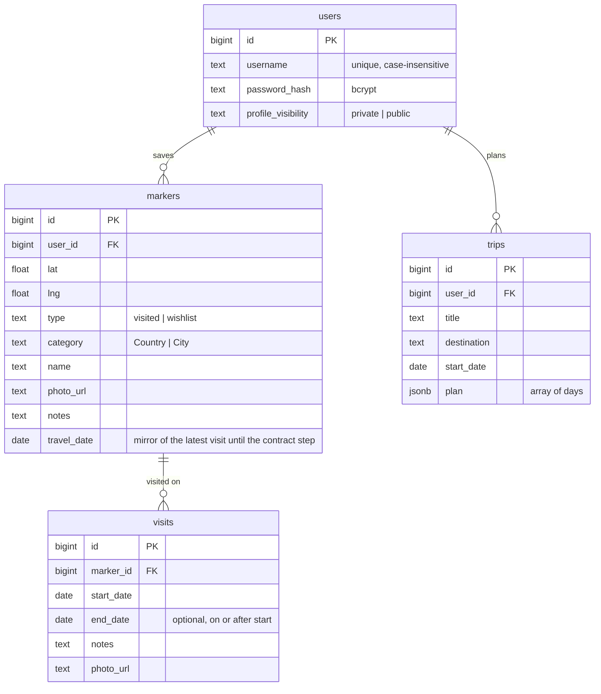

# Data Model

PostgreSQL holds all user data. The schema lives in `src/db/migrations/`; field limits are
enforced both there and in `src/validation.js`.

## Relationships

## Tables

| Table | Contents and rules |
|---|---|
| `users` | `username` is 3–32 of `A-Z a-z 0-9 _ . -`, unique regardless of case. Passwords are 8–72 bytes and stored only as bcrypt hashes (cost 12). `profile_visibility` defaults to `private`. |
| `markers` | A saved place ("marker" in the API). `name` 1–200 characters, `notes` up to 2,000, `photo_url` an HTTP(S) URL up to 2,048. Coordinates are range-checked. `travel_date` only mirrors the start of the latest visit for the previous release ([below](#places-and-visits)). |
| `visits` | One stay at a place: `start_date` required, `end_date` optional and never before the start, `notes` up to 2,000, `photo_url` an HTTP(S) URL up to 2,048. At most 500 per place when created with it or imported. |
| `trips` | `title` 1–120 and `destination` 1–160 characters, optional `start_date`. `plan` is a JSON array of 1–30 days, each with `morning`, `afternoon` and `evening` text of up to 500 characters. |
| `sessions` | Server-side sessions for `connect-pg-simple`; expired rows are pruned every 15 minutes. |
| `rate_limits` | Unlogged rate-limit counters per limiter and client IP, shared by replicas; expired rows are swept every 10 minutes. |
| `geocoder_throttle` | One row with the earliest start time of the next Nominatim request. |
| `schema_migrations` | Applied migration versions. |

All timestamps are `created_at`/`updated_at` (`timestamptz`). Deleting a user cascades to their
markers, their visits and trips; deleting a place removes its visits.

## Places And Visits

A place is saved once; each visit records one stay there
([ADR 0009](adr/0009-places-and-visits.md)). Visit dates are plain local calendar dates at the
destination, with no time or time zone, inclusive at both ends, and are returned as
`YYYY-MM-DD` strings. A missing end date means the end was not recorded. This is the base of the
planned day ledger, which will count days per country and city from these spans.

Migration 004 is the expand step of an expand-and-contract change: it backfilled one visit for
every place that had a `travel_date`, and keeps that column as a mirror of the latest visit with
triggers, so the previous release can keep reading and writing it. A date written the old way
only ever adds a visit. A later release drops the mirror and the triggers
([roadmap](../TODO.md)).

## Migrations

Files named `NNN_description.sql` run in order at startup, each in its own transaction, under a
PostgreSQL advisory lock so replicas never race. `npm run migrate` applies them without starting
the server. Migrations are forward-only: add a new file, never edit an applied one, and keep
changes compatible with the previous release while both may run during a rollout.

## Map Data

`public/data/` holds read-only reference data built by `scripts/build-map-data.js` from
[Natural Earth](https://www.naturalearthdata.com) (public domain) and
[GeoNames](https://www.geonames.org) `cities500` (CC BY 4.0, credited on the map):

| File | Contents |
|---|---|
| `countries.geojson` | 1:50m country borders simplified to 0.02°, with name, aliases, continent, population and label placement |
| `cities.json` | The base list loaded with the page: about 4,900 places shown by zoom 6, as objects with name, country, capital flag, population, `minZoom` and coordinates |
| `cities/index.json`, `cities/<tile>.json` | About 220,000 smaller places in region tiles of up to 4,000, as rows `[name, countryId, capital, population, minZoom, lat, lng]` |

Every GeoNames place of 500+ people is included, except city districts, historical and
abandoned places. `minZoom` is the first half zoom step at which the place's dot and name fit
beside the places shown before it, ranked by capitals, Natural Earth's curated label zooms and
population; places that never fit get `11.5` and show as dots at the deepest zoom.

To rebuild, see [development](development.md#rebuilding-map-data).

## Import And Export

Export and import use the marker fields `id, lat, lng, type, name, category, photoUrl, notes,
travelDate`, where `travelDate` is the start of the latest visit:

- **JSON** nests each place's `visits` (`startDate, endDate, notes, photoUrl`), newest first.
- **CSV** has one row per visit, adding `visitStartDate, visitEndDate, visitNotes,
  visitPhotoUrl`; a place without visits has one row with those columns empty.

On import, rows of the same place (same type, kind and name) are joined and repeated visits
dropped. Files from before visits existed still import: their `travelDate` becomes the place's
only visit. A row with an invalid visit is skipped. The Places tab drops places that duplicate
an existing one, then `POST /api/markers/import` stores up to 1,000 places with their visits in
one transaction and reports the invalid rows it skipped.

## Privacy

Data is private to its owner. A public profile exposes username, coordinates, type, name,
category, latest travel date and visit dates of each place, never the notes or photo links of
places or visits ([security](security.md#privacy)). Deleting an account removes the user, their
places, visits, trips and sessions at once.
