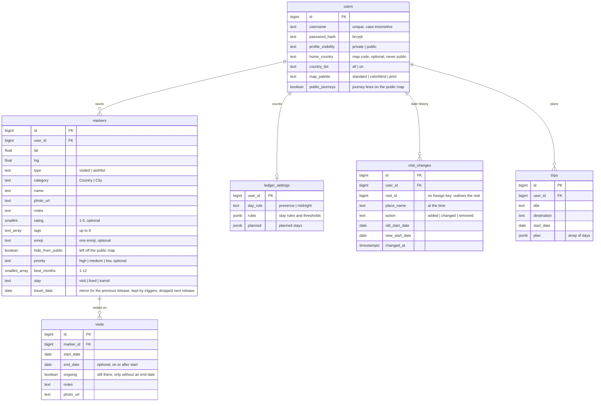

# Data Model

PostgreSQL holds all user data. The schema lives in `src/db/migrations/`; field limits are
enforced both there and in `src/validation.js`.

## Relationships

## Tables

| Table | Contents and rules |
|---|---|
| `users` | `username` is 3–32 of `A-Z a-z 0-9 _ . -`, unique regardless of case. Passwords are 8–72 bytes and stored only as bcrypt hashes (cost 12). `profile_visibility` defaults to `private`. `home_country` is an optional three-letter map code ([ADR 0014](adr/0014-home-lived-and-transit.md)); `country_list` is `all` (the default) or `un`, the countries the passport counts against ([ADR 0015](adr/0015-country-lists.md)). `map_palette` is `standard` (the default), `colorblind` or `print`, and `public_journeys` (default false) lets visitors of a public map see journey lines ([ADR 0016](adr/0016-timeline-journeys-and-palettes.md)). |
| `markers` | A saved place ("marker" in the API). `name` 1–200 characters, `notes` up to 2,000, `photo_url` an HTTP(S) URL up to 2,048. Coordinates are range-checked. `rating` is 1–5 or empty; `tags` holds up to 8 lowercase tags of 1–24 letters or digits (with inner spaces, dashes, apostrophes or ampersands); `emoji` is a single emoji of at most 16 code points ([ADR 0012](adr/0012-place-details.md)). `hide_from_public` keeps the place and its visits off the owner's public map ([ADR 0013](adr/0013-hidden-places.md)). For wishlist plans, `priority` is `high`, `medium`, `low` or empty and `best_months` holds month numbers 1–12. `stay` says how the traveler was at a place they have been to: `visit` (the default), `lived` or `transit`; the API keeps it at `visit` for wishlist places and reads it only for visited ones. `travel_date` only mirrors the start of the latest visit for the previous release ([below](#places-and-visits)). |
| `visits` | One stay at a place: `start_date` required, `end_date` optional and never before the start, `ongoing` true for a stay still going on (the API refuses it with an end date), `notes` up to 2,000, `photo_url` an HTTP(S) URL up to 2,048. At most 500 per place when created with it or imported. |
| `ledger_settings` | One row per traveler once they save: `day_rule`, and JSON arrays `rules` (at most 20 stay rules and thresholds, each with an id, name, 1–80 three-letter country codes, day counts and a warning margin) and `planned` (at most 30 stays with a country and first and last day). Validated in `validation.js`. |
| `visit_changes` | Append-only history of visit dates written by triggers: old and new `start_date`, `end_date` and `ongoing` of each added, changed or removed visit, with the place name and time. Kept after the visit or place is removed. |
| `trips` | `title` 1–120 and `destination` 1–160 characters, optional `start_date`. `plan` is a JSON array of 1–30 days, each with `morning`, `afternoon` and `evening` text of up to 500 characters. |
| `sessions` | Server-side sessions for `connect-pg-simple`; expired rows are pruned every 15 minutes. |
| `rate_limits` | Unlogged rate-limit counters per limiter and client IP, shared by replicas; expired rows are swept every 10 minutes. |
| `geocoder_throttle` | One row with the earliest start time of the next Nominatim request. |
| `schema_migrations` | Applied migration versions. |

All timestamps are `created_at`/`updated_at` (`timestamptz`). Deleting a user cascades to their
markers, their visits, trips, ledger settings and date history; deleting a place removes its
visits and records them as removed in the history.

## Places And Visits

A place is saved once; each visit records one stay there
([ADR 0009](adr/0009-places-and-visits.md)). Visit dates are plain local calendar dates at the
destination, with no time or time zone, inclusive at both ends, and are returned as
`YYYY-MM-DD` strings. A visit without an end date is either still going on (`ongoing`) or its
end was not recorded. The [day ledger](#day-ledger) counts days per country from these spans.

Migration 004 is the expand step of an expand-and-contract change: it backfilled one visit for
every place that had a `travel_date`, and keeps that column as a mirror of the latest visit with
triggers, so the previous release can keep reading and writing it. A date written the old way
only ever adds a visit. Since 1.10.0 the app itself never reads or writes the column: a
`travelDate` sent by an old tab or found in a file becomes a visit in the app, by the same rule.
The release after it drops the mirror and the triggers ([roadmap](../TODO.md),
[ADR 0009](adr/0009-places-and-visits.md)).

Migration 006 added `rating`, `tags` and `emoji` to `markers` with defaults; the previous
release never writes them, and the API changes them only when a request sends them, so its
updates keep them ([ADR 0012](adr/0012-place-details.md)). Migration 007 added
`hide_from_public` the same way, defaulting to shared; the previous release does not filter
on it, so its replicas list hidden places on public maps while they run
([ADR 0013](adr/0013-hidden-places.md)). Migration 008 added `priority` and `best_months` the
same way as 006. Migration 009 added `markers.stay` (default `visit`) and `users.home_country`
the same way; the previous release reads lived-in and transit places as plain visits, and a
place it moves to the wishlist keeps its old `stay`, which the API ignores for wishlist places
([ADR 0014](adr/0014-home-lived-and-transit.md)). Migration 010 added `users.country_list` with
the default `all`, which counts every territory as the previous release does
([ADR 0015](adr/0015-country-lists.md)). Migration 011 added `users.map_palette` (default
`standard`) and `users.public_journeys` (default false); the previous release never reads them
([ADR 0016](adr/0016-timeline-journeys-and-palettes.md)).

## Day Ledger

Counting runs in the browser (`public/js/days.js`, [ADR 0010](adr/0010-day-ledger.md)):

| Rule | How a visit counts |
|---|---|
| Any part of a day (`presence`) | Every day from the first to the last day, both included |
| Midnight rule (`midnight`) | Every night: the first day up to the day before the last; a same-day visit counts none |
| Still going on (`ongoing`) | Through today under either rule, or the first day if it starts later |
| End not recorded | The first day only, under either rule, flagged in the tab and the report |

A city counts for its country, and a day counts once per country (or group of countries)
however many places hold it. Every place counts its visits whatever its status: days where the
traveler lived and dated layovers are presence days like any visit, and the home country adds
no days by itself ([ADR 0014](adr/0014-home-lived-and-transit.md)). Days before 1900 or more than ten years ahead are ignored. Schengen
90/180 always counts any part of a day; the traveler's day rule applies to day counters, tax
thresholds and evidence reports, and each custom stay rule has its own.

Migration 005 added `visits.ongoing` (default false, so the previous release keeps working),
`ledger_settings` and `visit_changes` with its triggers. The history records writes of the
previous release too, skips edits to notes and photo links, and starts with that migration.

## Migrations

Files named `NNN_description.sql` run in order at startup, each in its own transaction, under a
PostgreSQL advisory lock so replicas never race. `npm run migrate` applies them without starting
the server. Migrations are forward-only: add a new file, never edit an applied one, and keep
changes compatible with the previous release while both may run during a rollout.

## Map Data

`public/data/` holds read-only reference data built by `scripts/build-map-data.js` from
[Natural Earth](https://www.naturalearthdata.com) (public domain) and
[GeoNames](https://www.geonames.org) `cities500` (CC BY 4.0, credited on the map):

| File | Contents |
|---|---|
| `countries.geojson` | 1:50m country borders simplified to 0.02°, with name, aliases, continent, population and label placement |
| `cities.json` | The base list loaded with the page: about 4,900 places shown by zoom 6, as objects with name, country, capital flag, population, `minZoom` and coordinates |
| `cities/index.json`, `cities/<tile>.json` | About 220,000 smaller places in region tiles of up to 4,000, as rows `[name, countryId, capital, population, minZoom, lat, lng]` |

Every GeoNames place of 500+ people is included, except city districts, historical and
abandoned places. `minZoom` is the first half zoom step at which the place's dot and name fit
beside the places shown before it, ranked by capitals, Natural Earth's curated label zooms and
population; places that never fit get `11.5` and show as dots at the deepest zoom.

Each feature is a territory as Natural Earth draws it, following who controls an area on the
ground; disputed and partially recognized territories such as Kosovo, Taiwan, Western Sahara,
Northern Cyprus, Somaliland and the Siachen Glacier are features of their own. The passport
counts them according to the traveler's country list, and a place is never moved to another
territory ([ADR 0015](adr/0015-country-lists.md)).

To rebuild, see [development](development.md#rebuilding-map-data).

## Import And Export

Export and import use the marker fields `id, lat, lng, type, name, category, photoUrl, notes,
travelDate, rating, tags, emoji, hideFromPublic, priority, bestMonths, stay`, where `travelDate` is
the start of the latest visit, `tags` and `bestMonths` are lists in JSON and one cell separated
by semicolons in CSV, `hideFromPublic` is `true` in JSON and `yes` in CSV, and `stay` is
`visit`, `lived` or `transit` (a wishlist place is always `visit`):

- **JSON** nests each place's `visits` (`startDate, endDate, notes, photoUrl, ongoing`), newest
  first.
- **CSV** has one row per visit, adding `visitStartDate, visitEndDate, visitNotes,
  visitPhotoUrl, visitOngoing` (`yes` for a stay still going on); a place without visits has one
  row with those columns empty.

On import, rows of the same place (same type, kind and name) are joined and repeated visits
dropped. Files from before visits existed still import: their `travelDate` becomes the place's
only visit. Files without ratings, tags or emoji import with none, their places are shared
on the public map, and places without `stay` are plain visits. A row with an invalid visit is skipped. The Places tab drops places that duplicate
an existing one, then `POST /api/markers/import` stores up to 1,000 places with their visits in
one transaction and reports the invalid rows it skipped.

## Privacy

Data is private to its owner. A public profile exposes username, the country list it is counted
on, coordinates, type, stay, name,
category, latest travel date and visit dates of each place, and whether journey lines may be
drawn between them, never the map palette, the home country, the notes or
photo links of places or visits, ratings, tags, emoji or wishlist plans, nor anything of the places hidden from it, whether a stay is still going on, ledger settings or date history
([security](security.md#privacy)). Deleting an account removes the user, their
places, visits, ledger settings, date history, trips and sessions at once.
